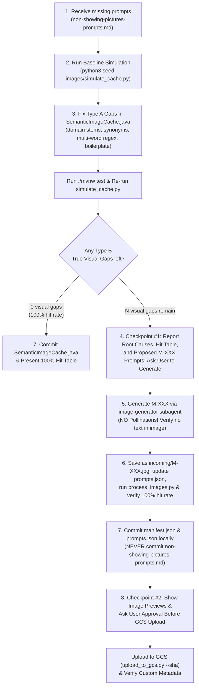

# Missing Cache Prompt Analysis & Remediation Skill

Use this skill whenever:
1. The user provides a batch of story sentences/prompts that did not hit the cache (e.g. in `.agents/skills/gcs-image-seeding/non-showing-pictures-prompts.md` or pasted into chat).
2. Live story sessions trigger fallback image generation instead of returning cached illustrations.
3. You need to analyze why semantic similarity fell below the `0.55` threshold, fix backend matching logic, and generate new seed images only where true visual gaps exist.

> [!NOTE]
> For the physical pipeline that resizes images to `768x336`, generates SHA-256 folders, and uploads to GCS, see the companion skill:
> **[`gcs-image-seeding`](file:///Users/mesutuluag/Documents/codingProjects/practice-portuguese/Portugese-for-Kids-Backend/.agents/skills/gcs-image-seeding/SKILL.md)**.

---

## 1. Core Architecture & Failure Categories

Every incoming story prompt passes through [`SemanticImageCache.java`](file:///Users/mesutuluag/Documents/codingProjects/practice-portuguese/Portugese-for-Kids-Backend/src/main/java/com/mesutuluag/portugeseforkidsbackend/image/SemanticImageCache.java). It calculates TF-IDF cosine similarity against all cached candidate illustrations. A cache hit requires **$\text{score} \ge 0.55$** and **no cross-domain conflict**.

When a prompt fails to hit the cache, it falls into one of two distinct categories:

### Type A: Vocabulary / Cache Logic Gap (Fix in Java Backend — Zero New Images Needed)
An appropriate illustration already exists in the cache, but the query misses it due to:
* **Domain Stem Contamination (Cross-Domain Lock):** A secondary object in the prompt contains a word from another theme's `DOMAIN_STEMS` (e.g. `"bank card"` at a pharmacy triggering `"bank"`, `"convenience shop"` at a petrol station triggering `"store"`). Because `DOMAIN_STEMS` carry a `2x` weight boost and enforce a strict cross-domain disjoint guard, this blocks the true scene from matching. Fixed via multi-word phrase normalization in `tokenise()` (e.g. `.replaceAll("\\bbank\\s+cards?\\b", "card")`).
* **Missing Domain Stems** in `DOMAIN_STEMS`: e.g. `"waiter"` or `"whiteboard"` not receiving the `2x` domain anchor boost when the prompt omits the literal location word (`"restaurant"`, `"school"`).
* **Missing Synonyms** in `SYNONYMS`: e.g. `"student"` / `"pupil"` mapped to generic `"child"` instead of `"school"`, `"patient"` not mapped to `"person"`, `"wine"` not mapped to `"drink"`, `"codfish"` not mapped to `"cod"`.
* **Uncontracted Multi-Word Phrases** in `tokenise()`: e.g. `"medical office"` not collapsed to `"hospital"`, `"display screen"` not collapsed to `"board"`, `"drink order"` not collapsed to `"order"`.
* **Unfiltered Boilerplate/Filler Words** in `BOILERPLATE_WORDS`: e.g. `"room"`, `"math"`, `"away"`, `"fetch"`, `"gesturing"`, `"symptoms"` inflating the query vector L2 norm and dropping cosine similarity by `0.08–0.15`.

*Resolution:* Update `SemanticImageCache.java`, run `./mvnw test` (ensuring existing unit test constraints like `KEEP_ER_OR_NOUNS` pass), and re-run `simulate_cache.py`. **Zero image generation needed.**

### Type B: True Visual Gap (Generate New Seed Images)
Even after Type A vocabulary/domain normalization, no existing illustration in the cache depicts the core setting, action, or subject (e.g. a waiter serving a bread basket, a family ordering two plates of codfish, a parent pulling a queue ticket from a machine).

*Resolution:* Propose the minimal set of `M-XXX` seed prompts to the user, generate via the `image-generator` subagent (NEVER Pollinations), process via `process_images.py`, and upload to GCS following the [`gcs-image-seeding`](file:///Users/mesutuluag/Documents/codingProjects/practice-portuguese/Portugese-for-Kids-Backend/.agents/skills/gcs-image-seeding/SKILL.md) skill.

---

## 2. Standard Operating Procedure (Step-by-Step)



### Step 1: Ingest & Parse Missing Prompts
Prompts in `non-showing-pictures-prompts.md` typically appear as JSON Lines with escaped strings:
```json
{
"content": "{\"pt\":\"Com certeza, trago já o pão.\",\"en\":\"Certainly, I will bring the bread now.\",\"imagePrompt\":\"a friendly waiter bringing a basket of fresh bread to a wooden table, colorful cute kids illustration, storybook art, bright colors, simple background, no text\"}"
}
```
Ensure `seed-images/manifest.json` and `Portugese-for-Kids-Backend/seed-images/manifest.json` are in sync with the current GCS bucket count before simulating.

### Step 2: Run the Dynamic Simulation Tool
Run [`seed-images/simulate_cache.py`](file:///Users/mesutuluag/Documents/codingProjects/practice-portuguese/seed-images/simulate_cache.py), which **dynamically parses** `STOP_WORDS`, `BOILERPLATE_WORDS`, `KEEP_ER_OR_NOUNS`, `DOMAIN_STEMS`, `SYNONYMS`, and `tokenise()` regex rules straight from `SemanticImageCache.java`:
```bash
# Default run (auto-detects non-showing-pictures-prompts.md):
python3 seed-images/simulate_cache.py

# Custom input file:
python3 seed-images/simulate_cache.py --input path/to/missing_prompts.md
```
For every prompt, `simulate_cache.py` outputs:
* `[HIT]` ($\ge 0.55$) or `[MISS]` ($< 0.55$)
* Best matched candidate ID (`M-XX`) and top-3 candidates with cosine similarity scores
* For misses: active query tokens, detected domain stems, and **Domain-blocked candidates** (if a higher-scoring candidate was rejected by the cross-domain guard).

### Step 3: Remediate Type A Gaps in `SemanticImageCache.java`
1. Open [`SemanticImageCache.java`](file:///Users/mesutuluag/Documents/codingProjects/practice-portuguese/Portugese-for-Kids-Backend/src/main/java/com/mesutuluag/portugeseforkidsbackend/image/SemanticImageCache.java).
2. Fix **Domain Stem Contamination** or multi-word phrases in `tokenise()`:
   ```java
   .replaceAll("\\bmedical\\s+(?:office|room|center|centre)s?\\b", "hospital")
   ```
3. Add missing anchor stems to `DOMAIN_STEMS` (e.g. `"waiter"`, `"whiteboard"`).
4. Add missing vocabulary mappings to `SYNONYMS` (mindful of `KEEP_ER_OR_NOUNS` and existing tests in `SemanticImageCacheTest.java`).
5. Add non-visual filler words to `BOILERPLATE_WORDS`.
6. Run the full backend test suite to verify zero regressions:
   ```bash
   cd Portugese-for-Kids-Backend && ./mvnw test
   ```
7. Re-run `python3 seed-images/simulate_cache.py` (it automatically reloads your `SemanticImageCache.java` changes) to see how many prompts now hit existing cached images.

### Step 4: Checkpoint #1 — Present Analysis & Ask Before Generating Type B Images
If all prompts now hit ($\ge 0.55$), commit `SemanticImageCache.java` and present the 100% hit table.
If **Type B True Visual Gaps** remain (and the user did not already instruct you to generate images immediately):
1. Present the **Root Cause Breakdown** and the **Post-Fix Simulation Table** showing which prompts now hit existing cached images and which still miss.
2. List the exact **`M-XXX` IDs and proposed prompts** needed to cover the remaining visual gaps.
3. **Ask the user for confirmation** to generate those `M-XXX` illustrations.

### Step 5: Generate Type B Illustrations via `image-generator` Subagent
Once confirmed:
1. Determine the next sequential IDs in [`prompts.json`](file:///Users/mesutuluag/Documents/codingProjects/practice-portuguese/seed-images/prompts.json) (e.g. `M-150`, `M-151`).
2. Draft each prompt with the mandatory style suffix:
   ```text
   "<subject and action in Portuguese setting>, colorful cute kids illustration, storybook art, bright colors, simple background, no text"
   ```
3. Invoke the `image-generator` subagent using `invoke_subagent`:
   > [!CAUTION]
   > **NEVER use Pollinations to generate seed images.** Always use the `image-generator` subagent (Gemini Imagen).
4. Inspect generated images: confirm landscape composition, cute colorful storybook style, and **strictly zero visible letters, words, or numbers**.

### Step 6: Process, Register & Verify 100% Hit Rate
1. Copy each generated image into `seed-images/incoming/M-XXX.jpg` (must be named `M-XXX.jpg` with companion `seed-images/incoming/M-XXX.txt` containing the exact prompt so `manifest.json` records `"id": "M-XXX"`).
2. Add `"M-XXX": "<prompt>"` to **both** [`seed-images/prompts.json`](file:///Users/mesutuluag/Documents/codingProjects/practice-portuguese/seed-images/prompts.json) and [`Portugese-for-Kids-Backend/seed-images/prompts.json`](file:///Users/mesutuluag/Documents/codingProjects/practice-portuguese/Portugese-for-Kids-Backend/seed-images/prompts.json).
3. Run the processing pipeline (resizes to `768x336`, flattens alpha to white, compresses to 60% JPEG, writes `processed/<sha256>/image.jpg` + `prompt.txt`, and updates `manifest.json`):
   ```bash
   python3 seed-images/process_images.py
   ```
4. Sync `manifest.json` (and optional processed folders) to the backend directory:
   ```bash
   cp seed-images/manifest.json Portugese-for-Kids-Backend/seed-images/manifest.json
   cp -R seed-images/processed/* Portugese-for-Kids-Backend/seed-images/processed/
   ```
5. Re-run the simulator and confirm **100.0% Hit Rate (`Misses: 0`)**:
   ```bash
   python3 seed-images/simulate_cache.py
   ```

### Step 7: Local Git Commits
Stage and commit code and metadata changes locally in `Portugese-for-Kids-Backend`:
```bash
git -C Portugese-for-Kids-Backend add \
  src/main/java/com/mesutuluag/portugeseforkidsbackend/image/SemanticImageCache.java \
  src/test/java/com/mesutuluag/portugeseforkidsbackend/image/SemanticImageCacheTest.java
git -C Portugese-for-Kids-Backend commit -m "fix(cache): update domain stems and synonym normalisation"

git -C Portugese-for-Kids-Backend add seed-images/manifest.json seed-images/prompts.json
git -C Portugese-for-Kids-Backend commit -m "feat(seed): register M-XXX to M-YYY seed images in manifest and prompts"
```

> [!WARNING]
> **Git Safety Guardrails:**
> 1. **NEVER commit `non-showing-pictures-prompts.md` or plan/audit markdown files to Git.**
> 2. **NEVER run unsandboxed `git push` without the user explicitly asking.**

### Step 8: Checkpoint #2 — User Approval & GCS Upload
1. Present the generated image previews (``) and the final **100% Cache Hit Simulation Table** to the user.
2. **STOP and ask for explicit user approval** before uploading to `gs://portugese-kids-image-cache/image-cache/`.
3. Once approved, upload each new hash via `upload_to_gcs.py` (using `BypassSandbox: true` when `gcloud` requires access to `~/.config/gcloud/credentials.db`):
   ```bash
   python3 seed-images/upload_to_gcs.py --sha <hash_prefix>
   ```
4. Verify each uploaded object in GCS:
   ```bash
   gcloud storage objects describe "gs://portugese-kids-image-cache/image-cache/<full_sha256>/image.jpg"
   ```
   Confirm `content_type: image/jpeg`, `size` (~35–65 KB), and `custom_fields.prompt` are present.

---

## 3. Quick Reference Commands

| Action | Command |
|---|---|
| Run Live Cache Simulation | `python3 seed-images/simulate_cache.py` |
| Run Full Backend Unit Tests | `cd Portugese-for-Kids-Backend && ./mvnw test` |
| Process Incoming `M-XXX` Images | `python3 seed-images/process_images.py` |
| Dry-Run GCS Upload | `python3 seed-images/upload_to_gcs.py --sha <hash_prefix> --dry-run` |
| Upload Specific Hash to GCS | `python3 seed-images/upload_to_gcs.py --sha <hash_prefix>` |
| Verify Uploaded GCS Metadata | `gcloud storage objects describe "gs://portugese-kids-image-cache/image-cache/<sha256>/image.jpg"` |
