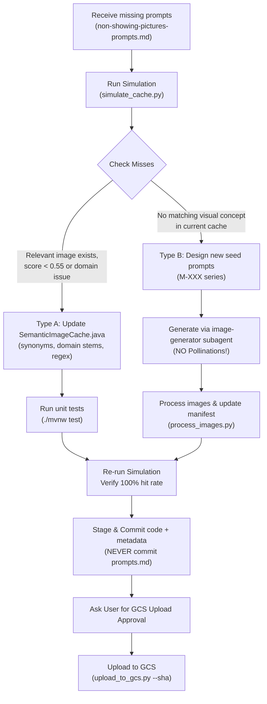

# Missing Cache Prompt Analysis & Remediation Skill

Use this skill whenever:
1. The user provides a batch of story sentences/prompts that did not hit the cache (e.g. in `.agents/skills/gcs-image-seeding/non-showing-pictures-prompts.md` or pasted into chat).
2. Live story sessions trigger fallback image generation instead of returning cached illustrations.
3. You need to analyze why semantic similarity fell below the `0.55` threshold, fix backend matching logic, and generate new seed images where real visual gaps exist.

> [!NOTE]
> For the physical pipeline that resizes images to `768x336`, generates SHA-256 folders, and uploads to GCS, see the companion skill:
> **[`gcs-image-seeding`](file:///Users/mesutuluag/Documents/codingProjects/practice-portuguese/Portugese-for-Kids-Backend/.agents/skills/gcs-image-seeding/SKILL.md)**.

---

## 1. Core Architecture & Failure Categories

Every incoming story prompt passes through [`SemanticImageCache.java`](file:///Users/mesutuluag/Documents/codingProjects/practice-portuguese/Portugese-for-Kids-Backend/src/main/java/com/mesutuluag/portugeseforkidsbackend/image/SemanticImageCache.java). It calculates TF-IDF cosine similarity against all cached candidate illustrations. A cache hit requires **$\text{score} \ge 0.55$** and **no domain conflict**.

When a prompt fails to hit the cache, it falls into one of two distinct categories:

### Type A: Vocabulary / Cache Logic Gap (Fix in Java Backend)
An appropriate illustration already exists in the cache, but the query misses it due to:
* **Missing Synonyms** in `SYNONYMS`: e.g. `"student"` or `"pupil"` mapped to `"child"` instead of `"school"`, `"waiter"` missing domain context, `"reception"` not mapped to `"receptionist"`.
* **Missing Domain Stems** in `DOMAIN_STEMS`: e.g. `"waiter"` or `"whiteboard"` not receiving the 2x domain anchor boost.
* **Uncontracted Multi-Word Phrases** in `tokenise()`: e.g. `"medical office"` not collapsed to `"hospital"`, `"display screen"` not collapsed to `"board"`.
* **Unfiltered Boilerplate/Filler Words** in `BOILERPLATE_WORDS`: e.g. `"room"`, `"math"`, `"away"`, `"fetch"`, `"gesturing"` inflating the query vector denominator.

*Resolution:* Update `SemanticImageCache.java`, run `./mvnw test`, and re-simulate. **Zero image generation needed.**

### Type B: True Visual Gap (Generate New Seed Images)
No existing illustration in the cache depicts the core setting, action, or subjects (e.g. a waiter serving a bread basket, a family eating codfish, a parent pulling a queue ticket from a machine).

*Resolution:* Craft targeted prompts, generate via the `image-generator` subagent (NEVER Pollinations), process via `process_images.py`, and upload to GCS following the [`gcs-image-seeding`](file:///Users/mesutuluag/Documents/codingProjects/practice-portuguese/Portugese-for-Kids-Backend/.agents/skills/gcs-image-seeding/SKILL.md) skill.

---

## 2. Standard Operating Procedure (Step-by-Step)



### Step 1: Ingest & Parse Missing Prompts
Prompts in `non-showing-pictures-prompts.md` typically appear as JSON Lines or escaped strings:
```json
{
"content": "{\"pt\":\"Com certeza, trago já o pão.\",\"en\":\"Certainly, I will bring the bread now.\",\"imagePrompt\":\"a friendly waiter bringing a basket of fresh bread to a wooden table, colorful cute kids illustration, storybook art, bright colors, simple background, no text\"}"
}
```
The automated simulation tool handles both raw escaped JSON lines and clean JSON objects.

### Step 2: Run the Simulation Tool
Run the cache simulator to evaluate every prompt against the current manifest (auto-detects `non-showing-pictures-prompts.md` by default):
```bash
# Default run:
python3 seed-images/simulate_cache.py

# Custom input file:
python3 seed-images/simulate_cache.py --input path/to/missing_prompts.md
```
The output displays for each prompt:
* Matched candidate ID (e.g. `M-147`)
* Cosine similarity score
* Top-3 candidates
* Active query tokens and detected domain stems
* Result: `[HIT]` ($\ge 0.55$) or `[MISS]`

### Step 3: Remediate Type A Gaps in `SemanticImageCache.java`
When an existing image would be suitable if tokens aligned:
1. Open [`SemanticImageCache.java`](file:///Users/mesutuluag/Documents/codingProjects/practice-portuguese/Portugese-for-Kids-Backend/src/main/java/com/mesutuluag/portugeseforkidsbackend/image/SemanticImageCache.java).
2. Check `SYNONYMS`: add missing word maps (e.g. `s.put("wine", "drink");`).
3. Check `DOMAIN_STEMS`: ensure anchor nouns receive the 2x boost (e.g. `"waiter"`, `"whiteboard"`).
4. Check multi-word regex in `tokenise()`:
   ```java
   .replaceAll("\\bmedical\\s+(?:office|room|center|centre)s?\\b", "hospital")
   ```
5. Check `BOILERPLATE_WORDS`: filter out neutral action/room filler tokens.
6. Verify unit tests:
   ```bash
   cd Portugese-for-Kids-Backend && ./mvnw test -Dtest=SemanticImageCacheTest
   ```

### Step 4: Remediate Type B Gaps via `image-generator` Subagent
When an action or visual element has no equivalent in the cache:
1. Determine the next available IDs in [`prompts.json`](file:///Users/mesutuluag/Documents/codingProjects/practice-portuguese/seed-images/prompts.json) (e.g. `M-147`, `M-148`, `M-149`).
2. Draft prompt text strictly adhering to project art guidelines:
   ```text
   "<subject and action in Portuguese setting>, colorful cute kids illustration, storybook art, bright colors, simple background, no text"
   ```
3. Invoke the `image-generator` subagent using `invoke_subagent`:
   > [!CAUTION]
   > **NEVER use Pollinations to generate seed images.** Use the official `image-generator` subagent (Gemini Imagen) exclusively.
4. Verify generated images: confirm 16:7 or landscape orientation, cute colorful storybook style, and **zero visible letters or numbers**.

### Step 5: Process and Register Seed Images
1. Copy raw images to `seed-images/incoming/<filename>` and write companion `<filename>.txt` with the exact prompt.
2. Add entries to `prompts.json` in both `seed-images/` and `Portugese-for-Kids-Backend/seed-images/`.
3. Run the processing pipeline:
   ```bash
   python3 seed-images/process_images.py
   ```
4. Sync processed directories:
   ```bash
   cp -R seed-images/processed/* Portugese-for-Kids-Backend/seed-images/processed/
   cp seed-images/manifest.json Portugese-for-Kids-Backend/seed-images/manifest.json
   ```

### Step 6: Verify 100% Cache Hit Rate
Re-run the simulator to verify that all prompts achieve `[HIT]`:
```bash
python3 seed-images/simulate_cache.py
```
Confirm:
* Total: `N`
* Hits: `N`
* Misses: `0`
* Hit Rate: `100.0%`

### Step 7: Local Git Commits
Stage and commit code and metadata changes locally:
```bash
git -C Portugese-for-Kids-Backend add \
  src/main/java/com/mesutuluag/portugeseforkidsbackend/image/SemanticImageCache.java \
  src/test/java/com/mesutuluag/portugeseforkidsbackend/image/SemanticImageCacheTest.java
git -C Portugese-for-Kids-Backend commit -m "fix(cache): update domain stems and synonym normalisation"

git -C Portugese-for-Kids-Backend add seed-images/manifest.json seed-images/prompts.json
git -C Portugese-for-Kids-Backend commit -m "feat(seed): register M-XXX to M-YYY seed images"
```

> [!WARNING]
> **Git Safety Guardrails:**
> 1. **NEVER commit `non-showing-pictures-prompts.md` or temporary audit markdown files to Git.**
> 2. **NEVER run unsandboxed `git push` without user asking.**

### Step 8: User Approval & GCS Upload
1. Present image previews and the full simulation breakdown table to the user.
2. **Obtain explicit user consent** before uploading to GCS.
3. Once approved, upload only the newly generated hashes:
   ```bash
   python3 seed-images/upload_to_gcs.py --sha <hash>
   ```
4. Verify in GCS:
   ```bash
   gcloud storage objects describe "gs://portugese-kids-image-cache/image-cache/<hash>/image.jpg"
   ```
   Ensure `custom_fields.prompt` is populated and `image.jpg` is readable.

---

## 3. Quick Reference Commands

| Action | Command |
|---|---|
| Run Cache Simulation | `python3 seed-images/simulate_cache.py --input <path>` |
| Run Unit Tests | `cd Portugese-for-Kids-Backend && ./mvnw test -Dtest=SemanticImageCacheTest` |
| Process New Images | `python3 seed-images/process_images.py` |
| Dry Run Upload | `python3 seed-images/upload_to_gcs.py --sha <hash> --dry-run` |
| Upload to GCS | `python3 seed-images/upload_to_gcs.py --sha <hash>` |
| Verify GCS Object | `gcloud storage objects describe "gs://portugese-kids-image-cache/image-cache/<sha>/image.jpg"` |
